# 四步相移条纹投影仿真

在带相机和投影仪的虚拟场景中生成灰度条纹，用于观察成像扰动对包裹相位和重建高度的影响。内置 140 个样件。000–127 是原有的 64 个石膏物体和 64 个结构化表面。128–133 为六类几何示例，134–139 补齐原先的 23 个独立头像。

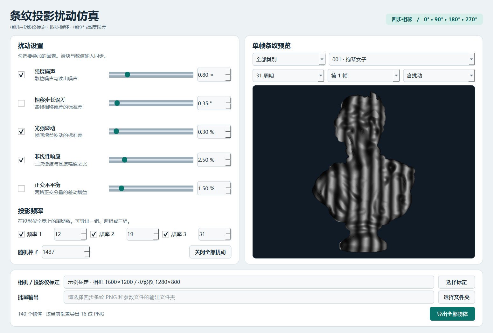

## 开始使用

安装 Python 3.10 或更新版本，下载仓库后进入项目目录。

**Windows PowerShell**

```powershell
py -m venv .venv
.\.venv\Scripts\python.exe -m pip install -r requirements.txt
.\.venv\Scripts\python.exe -m fringe_lab.gui
```

以后可以双击 `运行界面.cmd`。如果系统没有 `py` 命令，用 `python -m venv .venv` 创建环境。

**macOS / Linux**

```sh
python3 -m venv .venv
.venv/bin/python -m pip install -r requirements.txt
.venv/bin/python -m fringe_lab.gui
```

界面需要桌面环境。也可以直接用下面的命令行方式批量生成。

## 预览与导出

1. 选择物体类别和编号，再选择频率、帧号和预览模式。
2. 勾选要叠加的扰动，用滑块或数值框调整强度。切换到「理想」可对照原条纹。
3. 选择要生成的频率和输出目录，点击「导出全部物体」。每次生成一个新文件夹，界面可查看进度或取消。

| 扰动 | 数值含义 |
| --- | --- |
| 强度噪声 | 散粒噪声与读出噪声的缩放倍数 |
| 相移步长误差 | 各帧相移偏差的标准差（°） |
| 光强波动 | 帧间增益波动的标准差（%） |
| 非线性响应 | 三次谐波相对基波的幅度（%） |
| 正交不平衡 | 正交分量差动增益（%） |

默认在投影仪宽度上生成 12、19、31 个周期。每频四帧的标称相移依次为 0°、90°、180°、270°。预览按物体轮廓裁切，导出的灰度 PNG 保留完整的 1024×1024 视场和 16 位量化。输出目录使用图鉴编号，例如 `074/f031/step_090.png`。根目录的 `仿真参数.json` 记录频率、种子、扰动和标定。

几何真值为参考平面到模拟表面的轴向高度，示例参考距离为 420 mm。

### 命令行

在已激活的虚拟环境中运行：

```sh
python -m fringe_lab.export --output outputs --ids 0 64 128 --frequencies 12 19 31
python -m fringe_lab.validate_ideal --per-category 1
```

省略 `--ids` 导出全部样件。省略扰动参数生成理想条纹，具体选项见 `python -m fringe_lab.export --help`。

## 样件数据

样件清单在 `assets/catalog.json`。000–127 保留原数据编号。已有 17 个原头像包含在 000–063 中，另补齐 6 个。界面选择「原有石膏头像」可查看完整 23 个。

- `assets/objects/NNN.webp` 是无损外观图。
- `assets/objects/NNN.npz` 保存前景掩膜与可无损恢复的数值高度。
- 128–133 分别为自由曲面、薄壁叶片、孔槽与齿形、台阶与棱边、细节浮雕和生物形貌示例，各一件。程序按参数实时生成几何。

数值高度和掩膜为 1024×1024。可在项目目录用 Python 读回。外观图使用独立的画幅，软件中的条纹和掩膜使用相机采样网格。

```python
from fringe_lab.specimens import catalog, load_object_surface

height, mask = load_object_surface("assets/objects/000.npz")
height_mm = catalog()[0].height_scale_mm * height
```

`height` 是归一化数值，按样件的 `height_scale_mm` 换算为毫米。

## 示例标定

`calibration/system.json` 是可直接运行的虚拟标定。相机尺寸 1600×1200，投影仪尺寸 1280×800，长度单位为毫米。需要替换时，在界面选择结构相同的 JSON。若已有 MATLAB 的相机和投影仪标定对象，可以用 `calibration/export_matlab.m` 转为此格式。使用内置示例时直接运行 Python 程序即可。

理想条纹验证把 PNG 读回后再解相位和三角测量，以数值表面为基准计算误差。[查看验证记录](docs/ideal_validation.json)。


## 物体图鉴

编号与 Qt 下拉框及导出目录一致。各类别展示实际使用的外观缩略图。点击缩略图可查看单个样件。

### 原有石膏头像（23 个）

| 外观 | 外观 | 外观 | 外观 | 外观 | 外观 |
|  :---: |  :---: |  :---: |  :---: |  :---: |  :---: |
| <a href="docs/objects/000.png">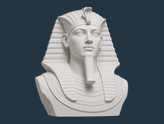</a><br>000 · 条纹头巾法老 | <a href="docs/objects/001.png">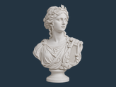</a><br>001 · 抱琴女子 | <a href="docs/objects/002.png">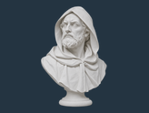</a><br>002 · 兜帽学者 | <a href="docs/objects/003.png">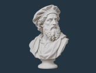</a><br>003 · 软帽长髯老人 | <a href="docs/objects/004.png">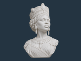</a><br>004 · 珠冠女王 | <a href="docs/objects/005.png">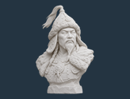</a><br>005 · 皮盔武士 |
| <a href="docs/objects/006.png">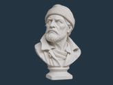</a><br>006 · 针织帽水手 | <a href="docs/objects/007.png">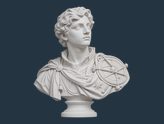</a><br>007 · 持星盘青年 | <a href="docs/objects/008.png">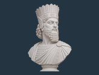</a><br>008 · 高冠卷须君主 | <a href="docs/objects/009.png">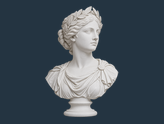</a><br>009 · 月桂发冠女子 | <a href="docs/objects/010.png"></a><br>010 · 链甲骑士 | <a href="docs/objects/011.png">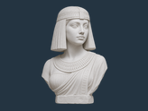</a><br>011 · 齐发头带女子 |
| <a href="docs/objects/012.png">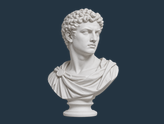</a><br>012 · 短卷发披肩青年 | <a href="docs/objects/013.png">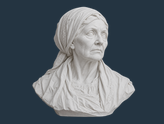</a><br>013 · 头巾老妇 | <a href="docs/objects/014.png"></a><br>014 · 抱弦乐器乐师 | <a href="docs/objects/015.png">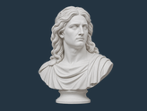</a><br>015 · 长发披袍学者 | <a href="docs/objects/016.png">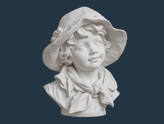</a><br>016 · 宽檐帽孩童 | <a href="docs/objects/134.png">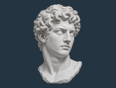</a><br>134 · 卷发青年 |
| <a href="docs/objects/135.png">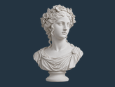</a><br>135 · 花冠贵妇 | <a href="docs/objects/136.png">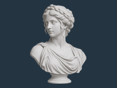</a><br>136 · 盘辫女子 | <a href="docs/objects/137.png"></a><br>137 · 方帽学士 | <a href="docs/objects/138.png">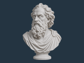</a><br>138 · 卷发长髯哲人 | <a href="docs/objects/139.png">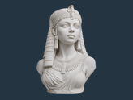</a><br>139 · 垂片头冠女子 |  |

### 其他石膏物体（47 个）

| 外观 | 外观 | 外观 | 外观 | 外观 | 外观 |
|  :---: |  :---: |  :---: |  :---: |  :---: |  :---: |
| <a href="docs/objects/017.png">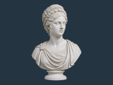</a><br>017 · 盘发罗马贵妇 | <a href="docs/objects/018.png">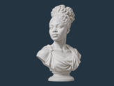</a><br>018 · 高髻女子 | <a href="docs/objects/019.png"></a><br>019 · 尖帽弄臣 | <a href="docs/objects/020.png">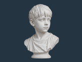</a><br>020 · 齐刘海男孩 | <a href="docs/objects/021.png">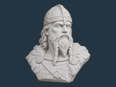</a><br>021 · 辫须北欧武士 | <a href="docs/objects/022.png">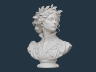</a><br>022 · 花冠植物学家 |
| <a href="docs/objects/023.png">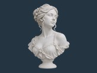</a><br>023 · 古典舞者头像 | <a href="docs/objects/024.png">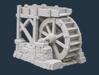</a><br>024 · 木架水车 | <a href="docs/objects/025.png">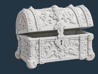</a><br>025 · 半开雕花木箱 | <a href="docs/objects/026.png">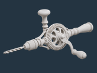</a><br>026 · 手摇古钻 | <a href="docs/objects/027.png">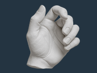</a><br>027 · 自然弯指手模 | <a href="docs/objects/028.png">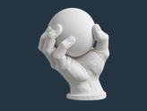</a><br>028 · 托球手模 |
| <a href="docs/objects/029.png"></a><br>029 · 旋梯灯塔 | <a href="docs/objects/030.png"></a><br>030 · 指向手模 | <a href="docs/objects/031.png">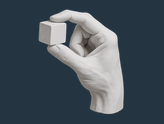</a><br>031 · 捏立方体手模 | <a href="docs/objects/032.png">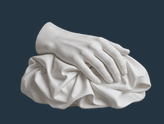</a><br>032 · 布面手模 | <a href="docs/objects/033.png">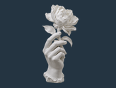</a><br>033 · 持花手模 | <a href="docs/objects/034.png">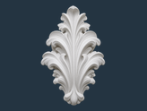</a><br>034 · 莨苕叶 |
| <a href="docs/objects/035.png"></a><br>035 · 枫叶浮雕 | <a href="docs/objects/036.png"></a><br>036 · 莲花 | <a href="docs/objects/037.png">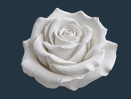</a><br>037 · 玫瑰 | <a href="docs/objects/038.png">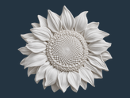</a><br>038 · 向日葵 | <a href="docs/objects/039.png">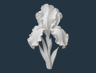</a><br>039 · 鸢尾花 | <a href="docs/objects/040.png">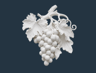</a><br>040 · 葡萄藤 |
| <a href="docs/objects/041.png">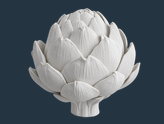</a><br>041 · 朝鲜蓟 | <a href="docs/objects/042.png">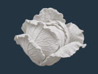</a><br>042 · 卷叶甘蓝 | <a href="docs/objects/043.png">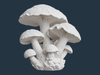</a><br>043 · 簇生蘑菇 | <a href="docs/objects/044.png">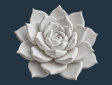</a><br>044 · 螺旋多肉 | <a href="docs/objects/045.png">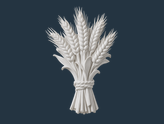</a><br>045 · 麦穗 | <a href="docs/objects/046.png">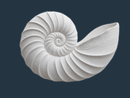</a><br>046 · 鹦鹉螺壳 |
| <a href="docs/objects/047.png">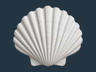</a><br>047 · 扇贝壳 | <a href="docs/objects/048.png">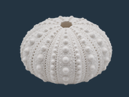</a><br>048 · 海胆壳 | <a href="docs/objects/049.png">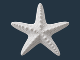</a><br>049 · 海星浮雕 | <a href="docs/objects/050.png">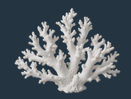</a><br>050 · 枝状珊瑚 | <a href="docs/objects/051.png"></a><br>051 · 菊石化石 | <a href="docs/objects/052.png"></a><br>052 · 三叶虫化石 |
| <a href="docs/objects/053.png"></a><br>053 · 深褶布料 | <a href="docs/objects/054.png"></a><br>054 · 篮编纹板 | <a href="docs/objects/055.png"></a><br>055 · 折纸鹤 | <a href="docs/objects/056.png"></a><br>056 · 折扇 | <a href="docs/objects/057.png"></a><br>057 · 褶皱帷幔 | <a href="docs/objects/058.png"></a><br>058 · 爱奥尼柱头 |
| <a href="docs/objects/059.png"></a><br>059 · 科林斯柱头 | <a href="docs/objects/060.png"></a><br>060 · 拱顶楔石 | <a href="docs/objects/061.png"></a><br>061 · 卷涡雕饰 | <a href="docs/objects/062.png"></a><br>062 · 雕花框角 | <a href="docs/objects/063.png"></a><br>063 · 天花花饰 |  |

### 结构化表面（64 个）

| 外观 | 外观 | 外观 | 外观 | 外观 | 外观 |
|  :---: |  :---: |  :---: |  :---: |  :---: |  :---: |
| <a href="docs/objects/064.png"></a><br>064 · 复合结构表面 064 | <a href="docs/objects/065.png"></a><br>065 · 复合结构表面 065 | <a href="docs/objects/066.png"></a><br>066 · 复合结构表面 066 | <a href="docs/objects/067.png"></a><br>067 · 复合结构表面 067 | <a href="docs/objects/068.png"></a><br>068 · 复合结构表面 068 | <a href="docs/objects/069.png"></a><br>069 · 复合结构表面 069 |
| <a href="docs/objects/070.png"></a><br>070 · 复合结构表面 070 | <a href="docs/objects/071.png"></a><br>071 · 复合结构表面 071 | <a href="docs/objects/072.png"></a><br>072 · 复合结构表面 072 | <a href="docs/objects/073.png"></a><br>073 · 复合结构表面 073 | <a href="docs/objects/074.png"></a><br>074 · 复合结构表面 074 | <a href="docs/objects/075.png"></a><br>075 · 复合结构表面 075 |
| <a href="docs/objects/076.png"></a><br>076 · 复合结构表面 076 | <a href="docs/objects/077.png"></a><br>077 · 复合结构表面 077 | <a href="docs/objects/078.png"></a><br>078 · 复合结构表面 078 | <a href="docs/objects/079.png"></a><br>079 · 复合结构表面 079 | <a href="docs/objects/080.png"></a><br>080 · 复合结构表面 080 | <a href="docs/objects/081.png"></a><br>081 · 复合结构表面 081 |
| <a href="docs/objects/082.png"></a><br>082 · 复合结构表面 082 | <a href="docs/objects/083.png"></a><br>083 · 复合结构表面 083 | <a href="docs/objects/084.png"></a><br>084 · 复合结构表面 084 | <a href="docs/objects/085.png"></a><br>085 · 复合结构表面 085 | <a href="docs/objects/086.png"></a><br>086 · 复合结构表面 086 | <a href="docs/objects/087.png"></a><br>087 · 复合结构表面 087 |
| <a href="docs/objects/088.png"></a><br>088 · 复合结构表面 088 | <a href="docs/objects/089.png"></a><br>089 · 复合结构表面 089 | <a href="docs/objects/090.png"></a><br>090 · 复合结构表面 090 | <a href="docs/objects/091.png"></a><br>091 · 复合结构表面 091 | <a href="docs/objects/092.png"></a><br>092 · 复合结构表面 092 | <a href="docs/objects/093.png"></a><br>093 · 复合结构表面 093 |
| <a href="docs/objects/094.png"></a><br>094 · 复合结构表面 094 | <a href="docs/objects/095.png"></a><br>095 · 复合结构表面 095 | <a href="docs/objects/096.png"></a><br>096 · 复合结构表面 096 | <a href="docs/objects/097.png"></a><br>097 · 复合结构表面 097 | <a href="docs/objects/098.png"></a><br>098 · 复合结构表面 098 | <a href="docs/objects/099.png"></a><br>099 · 复合结构表面 099 |
| <a href="docs/objects/100.png"></a><br>100 · 复合结构表面 100 | <a href="docs/objects/101.png"></a><br>101 · 复合结构表面 101 | <a href="docs/objects/102.png"></a><br>102 · 复合结构表面 102 | <a href="docs/objects/103.png"></a><br>103 · 复合结构表面 103 | <a href="docs/objects/104.png"></a><br>104 · 复合结构表面 104 | <a href="docs/objects/105.png"></a><br>105 · 复合结构表面 105 |
| <a href="docs/objects/106.png"></a><br>106 · 复合结构表面 106 | <a href="docs/objects/107.png"></a><br>107 · 复合结构表面 107 | <a href="docs/objects/108.png"></a><br>108 · 复合结构表面 108 | <a href="docs/objects/109.png"></a><br>109 · 复合结构表面 109 | <a href="docs/objects/110.png"></a><br>110 · 复合结构表面 110 | <a href="docs/objects/111.png"></a><br>111 · 复合结构表面 111 |
| <a href="docs/objects/112.png"></a><br>112 · 复合结构表面 112 | <a href="docs/objects/113.png"></a><br>113 · 复合结构表面 113 | <a href="docs/objects/114.png"></a><br>114 · 复合结构表面 114 | <a href="docs/objects/115.png"></a><br>115 · 复合结构表面 115 | <a href="docs/objects/116.png"></a><br>116 · 复合结构表面 116 | <a href="docs/objects/117.png"></a><br>117 · 复合结构表面 117 |
| <a href="docs/objects/118.png"></a><br>118 · 复合结构表面 118 | <a href="docs/objects/119.png"></a><br>119 · 复合结构表面 119 | <a href="docs/objects/120.png"></a><br>120 · 复合结构表面 120 | <a href="docs/objects/121.png"></a><br>121 · 复合结构表面 121 | <a href="docs/objects/122.png"></a><br>122 · 复合结构表面 122 | <a href="docs/objects/123.png"></a><br>123 · 复合结构表面 123 |
| <a href="docs/objects/124.png"></a><br>124 · 复合结构表面 124 | <a href="docs/objects/125.png"></a><br>125 · 复合结构表面 125 | <a href="docs/objects/126.png"></a><br>126 · 复合结构表面 126 | <a href="docs/objects/127.png"></a><br>127 · 复合结构表面 127 |  |  |

### 自由曲面（1 个）

| 外观 | 外观 | 外观 | 外观 | 外观 | 外观 |
|  :---: |  :---: |  :---: |  :---: |  :---: |  :---: |
| <a href="docs/objects/128.png"></a><br>128 · 鞍形壳 |  |  |  |  |  |

### 薄壁叶片（1 个）

| 外观 | 外观 | 外观 | 外观 | 外观 | 外观 |
|  :---: |  :---: |  :---: |  :---: |  :---: |  :---: |
| <a href="docs/objects/129.png"></a><br>129 · 扭转叶片 |  |  |  |  |  |

### 孔槽与齿形（1 个）

| 外观 | 外观 | 外观 | 外观 | 外观 | 外观 |
|  :---: |  :---: |  :---: |  :---: |  :---: |  :---: |
| <a href="docs/objects/130.png"></a><br>130 · 多齿直齿轮 |  |  |  |  |  |

### 台阶与棱边（1 个）

| 外观 | 外观 | 外观 | 外观 | 外观 | 外观 |
|  :---: |  :---: |  :---: |  :---: |  :---: |  :---: |
| <a href="docs/objects/131.png"></a><br>131 · 多层嵌套台阶 |  |  |  |  |  |

### 细节浮雕（1 个）

| 外观 | 外观 | 外观 | 外观 | 外观 | 外观 |
|  :---: |  :---: |  :---: |  :---: |  :---: |  :---: |
| <a href="docs/objects/132.png"></a><br>132 · 花饰浮雕 |  |  |  |  |  |

### 生物形貌（1 个）

| 外观 | 外观 | 外观 | 外观 | 外观 | 外观 |
|  :---: |  :---: |  :---: |  :---: |  :---: |  :---: |
| <a href="docs/objects/133.png"></a><br>133 · 多齿牙弓 |  |  |  |  |  |
